# Demo script

Draft for the owner (docs/clinic-cms/WAVE7.md, RD5). A fifteen-minute walkthrough of Salus for the owner of a private
clinic, in the order a clinic owner tends to ask: the front desk, a visit, the receipt, online hours, the patient app,
the numbers. Then three questions to ask the clinic.

Everything on screen is synthetic: the clinic "Poliklinika Primjer (demo)", its doctors and its sixty patients are made
up (the family names are Bosnian words for "example", "sample", "test" and "trial"), the phone numbers start +387 000,
which no operator uses, the e-mail addresses end in `example.test`, and the addresses are on "Ulica Primjera" (Example
Street). Clinical wording carries "(primjer)": no finding, result or message in the demo is real, and none is a
diagnosis.

## Before the visit

1. **A stack with an empty database.** `make demo-seed` fills only a fresh stack: it refuses a database that holds any
   clinic other than the demo clinic, so it never runs on top of real or development data. Use a checkout of its own
   (a `git worktree`, whose compose project and ports are its own, as `scripts/runner.sh start` sets them), or empty the
   Postgres volume of a stack whose data you do not need.
2. **Seed on the morning of the demo.** `make demo-seed` starts the stack (`make up`) and fills it in about half a
   minute. The month of visits is counted from that moment: four weeks behind, four weeks ahead, and today's visits at
   the front desk, the next one marked as arrived. A seed from the day before shows yesterday as today. Run it again and
   it changes nothing.
3. **Start the web app.** `make web-dev`, then open `http://localhost:5173` (the port is `SALUS_WEB_PORT` in
   `deployments/.env` when the checkout has its own).
4. **Add the TOTP secrets.** The seed prints a sign-in sheet: the password of every demo account and, for each staff
   member, the TOTP secret their account was enrolled with. Add the receptionist's, Dr. Emir Primjerović's and the
   clinic admin's to an authenticator app as "enter a setup key" (time-based). The sheet is printed once; a second run
   prints the accounts without the secrets (`salusctl reset-mfa <account-id>` enrols an account again).
5. **The patient app.** Run it on an emulator against the stack, as `README.md` "Mobile on a device or emulator"
   describes, and sign in as `pacijent2@demo.example.test` before the visit.
6. **Language.** The staff accounts use Bosnian; the language picker at the top switches any of them to Croatian,
   Serbian or English during the demo.

### Sign-in sheet

| Who | Where | E-mail | Second factor |
| --- | --- | --- | --- |
| Clinic admin | web | `uprava@demo.example.test` | TOTP from the seed's sheet |
| Reception (front desk) | web | `recepcija@demo.example.test` | TOTP |
| Dr. Emir Primjerović, general practice | web | `emir.primjerovic@demo.example.test` | TOTP |
| Dr. Selma Uzorković, cardiology | web | `selma.uzorkovic@demo.example.test` | TOTP |
| Dr. Tarik Testić, dermatology | web | `tarik.testic@demo.example.test` | TOTP |
| Dr. Maja Probić, paediatrics | web | `maja.probic@demo.example.test` | TOTP |
| Amra Primjerović, patient | app | `pacijent1@demo.example.test` | none |
| Adnan Uzorković, patient | app | `pacijent2@demo.example.test` | none |
| Lejla Testić, patient | app | `pacijent3@demo.example.test` | none |
| Haris Demić, patient | app | `pacijent4@demo.example.test` | none |
| Selma Probić, patient | app | `pacijent5@demo.example.test` | none |

The password of every demo account is `demo-lozinka-primjer`.

### What the demo clinic holds

- Two locations: Primjer Centar (Sarajevo) with three rooms and an ECG device, and Primjer Tuzla with two rooms.
- Four practitioners and a receptionist. Each practitioner has weekly hours at a location and a room; Dr. Primjerović,
  Dr. Uzorković and Dr. Testić also have evening video hours. Every day of the week has someone's hours.
- A price list of nine services in BAM, one of them no longer offered.
- Sixty patients: five use the patient app, the others were registered at the front desk with their consent given in
  person.
- About 500 visits over eight weeks, in every state: done, no-show, cancelled by the patient or by the clinic, booked,
  and one arrived at the desk today. About 170 receipts for the visits behind, one of them reversed.
- Two quotes, a released blood count, a booked three-step treatment plan, a questionnaire with branching (answered by
  one patient, waiting for another), a chat, two data requests, and the clinic's membership with its first invoice.

## The walkthrough

### 1. The front desk (3 minutes)

Sign in as **Reception** (`recepcija@demo.example.test`). The receptionist sees the front desk and nothing clinical.

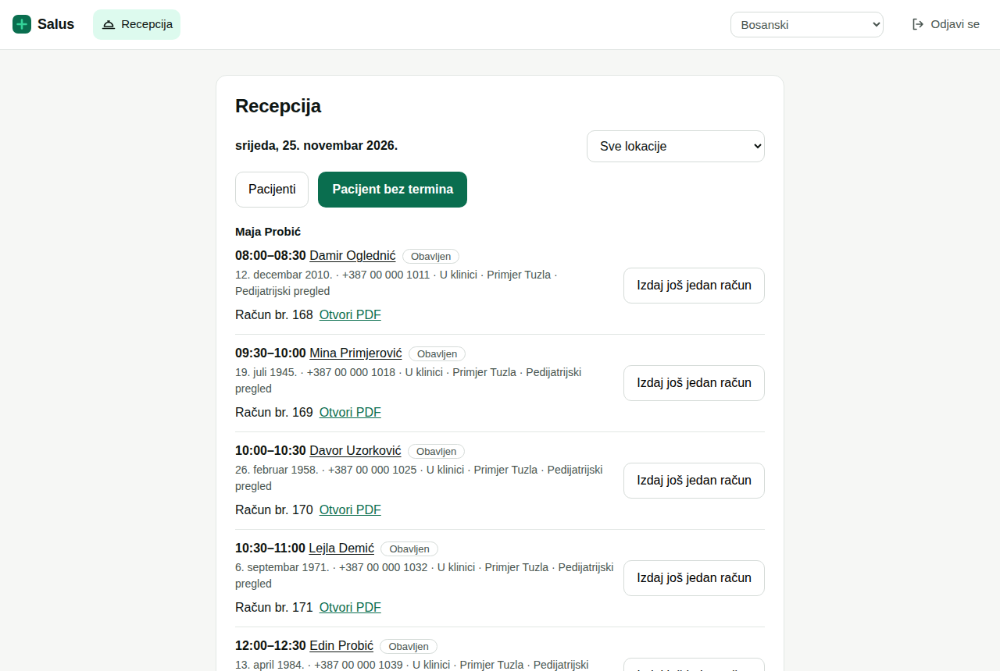

- Today's visits, by doctor, with each patient's birth date and phone, the place, the service and the state. The
  patient marked "Dolazak u …" has arrived and is in the waiting room.
- "Sve lokacije" filters the day by location: Sarajevo or Tuzla.
- "Pacijenti" finds a patient by name and books a visit for them; "Pacijent bez termina" registers a walk-in with their
  consent given in person.
- A visit that took place has its receipt and its PDF on the row; the others have "Izdaj račun" (issue a receipt),
  which is step 3.

What to say: the front desk works from one list for the whole day and every location, and the patient's consent is
recorded when they are registered.

### 2. A visit (3 minutes)

Sign in as **Dr. Emir Primjerović** (`emir.primjerovic@demo.example.test`).

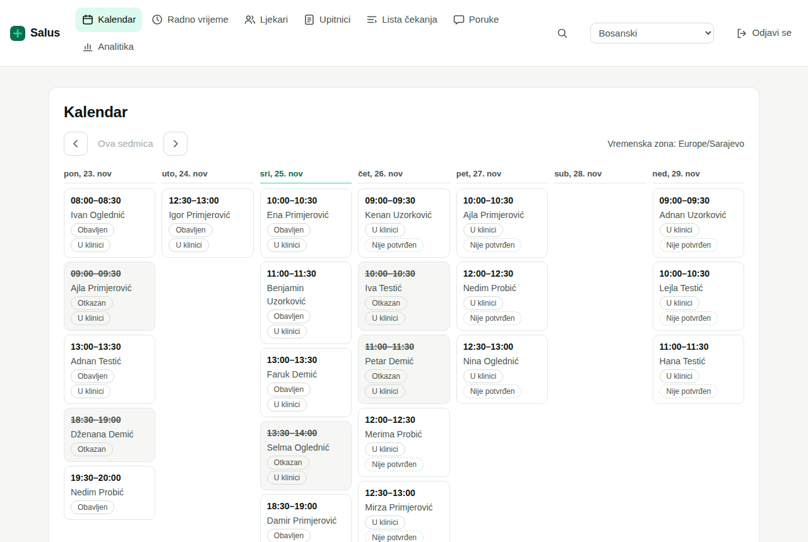

The calendar shows the doctor's week: visits done, cancelled (struck through), booked and not yet confirmed by the
patient, in the clinic and by video.

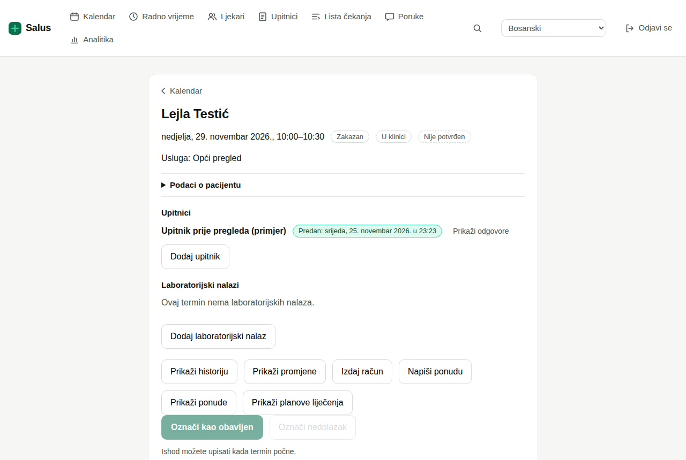

Open Lejla Testić's next visit: she filled in the clinic's form in the app before it. "Prikaži odgovore" shows her answers; the section about allergies and the smoking questions
appeared only because she answered yes.

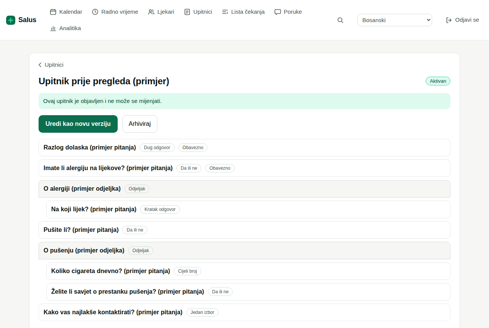

The form is built by dragging questions and sections; a section can depend on an earlier answer, and a question inside
it on a number (here: advice on quitting is offered above ten cigarettes a day).

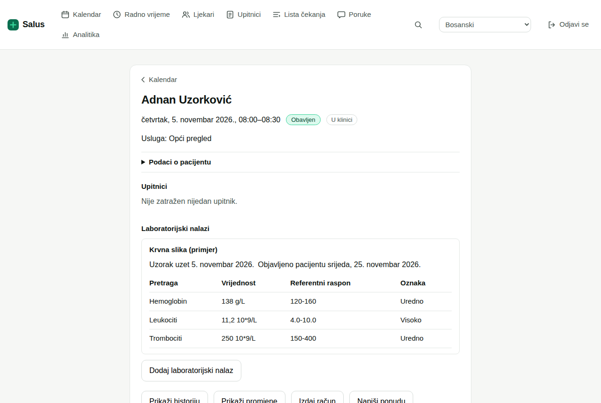

Adnan Uzorković's visit earlier this month has a blood count, released to him in the app. From the same visit the
doctor writes a quote, issues a receipt, or opens the patient's treatment plans.

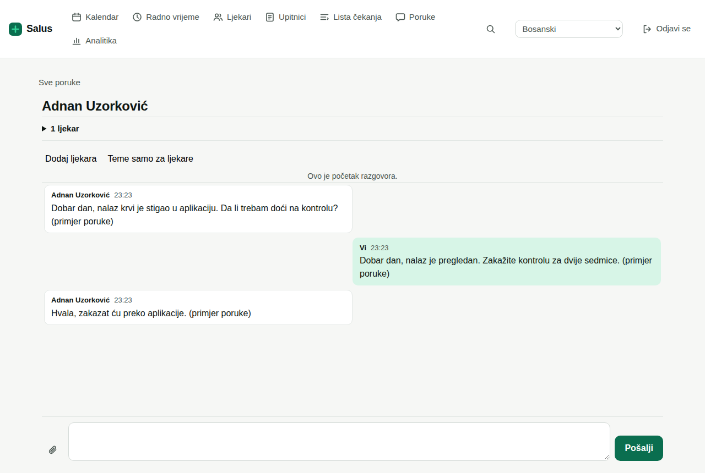

"Poruke": Adnan asked about his result in the app, and the doctor answered.

### 3. The receipt (2 minutes)

Back as **Reception**, issue a receipt for one of today's visits from its row ("Izdaj račun"): the service is the
visit's to start with, priced from the clinic's price list; add a line if needed, pick the payment method and
issue. The row then shows the receipt number
and its PDF.

Sign in as the **Clinic admin** (`uprava@demo.example.test`) and open "Računi".

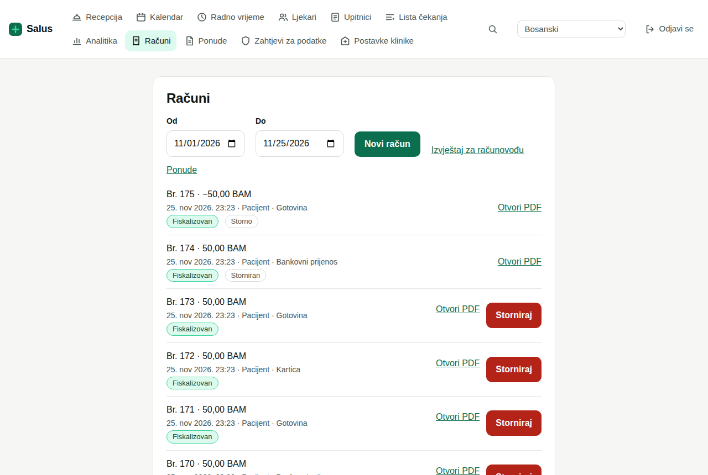

Every receipt is fiscalised when it is issued, numbered in sequence, and kept as it was issued; a mistaken one is
reversed ("Storniraj") with a reversing receipt, never edited or deleted. The newest pair in the list is a receipt and
its reversal.

Say plainly: in this demo the fiscalisation is simulated. The connection to the Tax Administration's system is built
once the technical specification and test access are available.

### 4. Online hours (2 minutes)

As **Dr. Emir Primjerović**, open "Radno vrijeme".

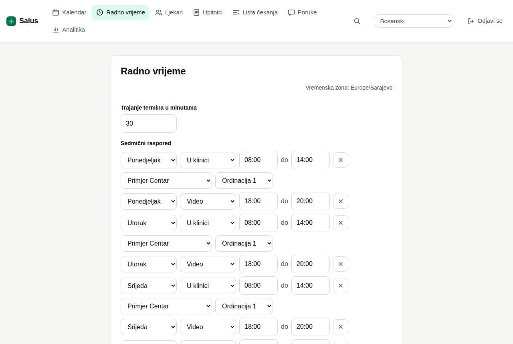

Each rule is a day, a time, and either a room at a location or video. Dr. Primjerović works mornings in Ordinacija 1 at
Primjer Centar and, Monday to Thursday, from 18:00 to 20:00 by video from home. Patients book those evening slots in
the app as video visits; the clinic sets the price of a video consultation in its price list.

As the **Clinic admin**, "Računi", then "Izvještaj za računovođu", then "Rad online i u klinici":

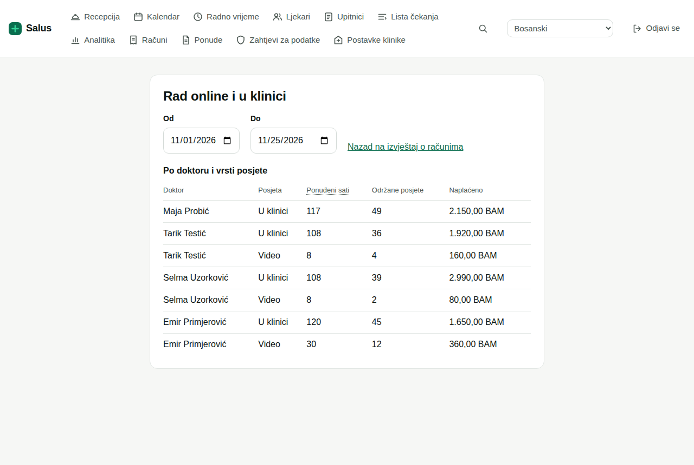

Hours offered, visits held and revenue per doctor, in the clinic and online, for any period.

### 5. The patient app (2 minutes)

No screenshots: the patient app is the Flutter app on a phone or an emulator, which this script's screenshots (taken in
a browser in a container) do not cover. Show it live, signed in as **Adnan Uzorković**
(`pacijent2@demo.example.test`):

- The clinic in the directory, with its locations and its price list; booking a visit in the clinic or by video.
- His visits, his blood count with the reference ranges, and the chat with Dr. Primjerović.
- His treatment plan: three visits already booked, one of them by video.

Then, if there is time: Amra Primjerović (`pacijent1@demo.example.test`) has a quote for a cardiology work-up, and
Haris Demić (`pacijent4@demo.example.test`) has a questionnaire waiting before his next visit. Patients pay at the
clinic; nothing is charged in the app.

### 6. The numbers (3 minutes)

As the **Clinic admin**, "Analitika":

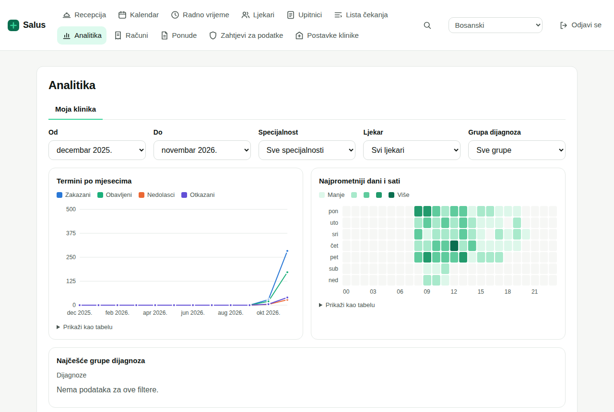

Visits booked, done, missed and cancelled by month, and the busiest days and hours, filtered by specialty or doctor.
The demo clinic's visits begin a month ago, so the earlier months are empty.

"Računi", then "Izvještaj za računovođu":

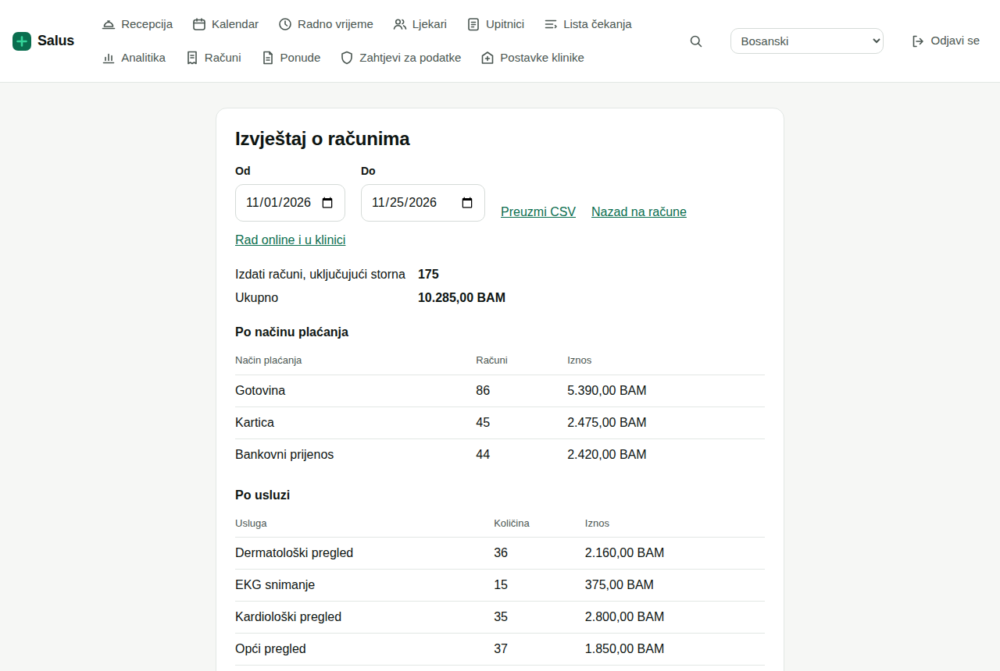

The period's receipts by payment method and by service, with a CSV for the accountant.

"Postavke klinike", then the membership:

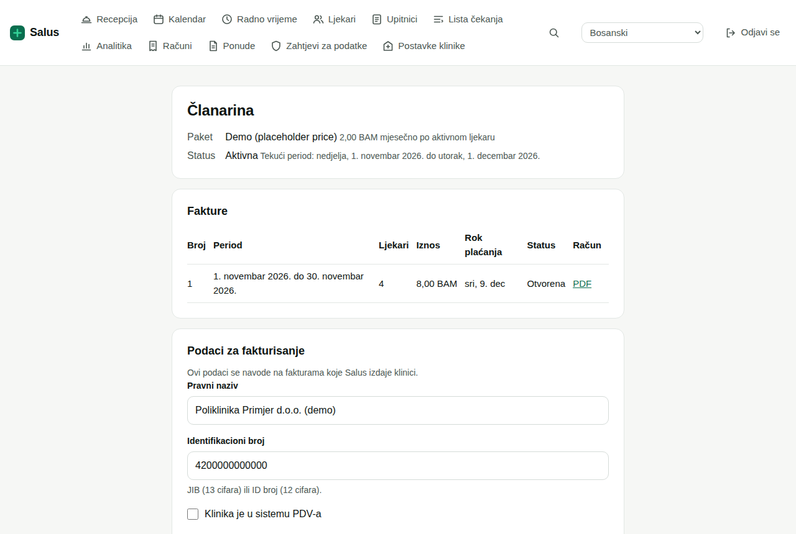

What the clinic pays Salus: a monthly membership per active practitioner, with its invoices. The plan's name and price
here are placeholders, not the price list.

If the clinic asks about patients' rights: "Zahtjevi za podatke" lists the patients' requests about their data with
their legal deadline; one asks for a correction and waits for the clinic's answer, the other (a copy of the data) Salus
answered with the patient's export.

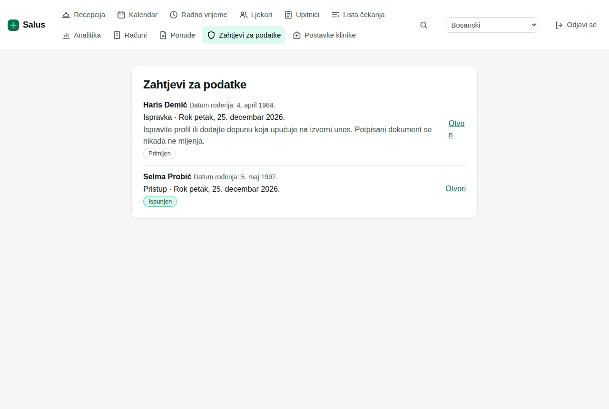

## Three questions to ask the clinic afterwards

1. How does a patient's day at your clinic run today, from the phone call to the receipt, and where does it go wrong
   most often?
2. Which of your doctors would see patients by video in the evening, and for which kinds of visit?
3. What would you need before you moved your price list, your patients and your receipts into Salus, and who at the
   clinic would decide?

## Retaking the screenshots

The screenshots are taken at 1280 px with Playwright, in the `playwright` container, against the checkout's own stack
right after `make demo-seed`:

    make web-install e2e-install
    DEMO_TOTP_ADMIN=… DEMO_TOTP_RECEPTION=… DEMO_TOTP_PRACTITIONER=… bash docs/demo/screenshots.sh

with the three secrets from the seed's sheet (the practitioner is Dr. Emir Primjerović). It writes
`docs/demo/screenshots/*.png` and nothing else. `0-price-list.png` and `0-locations.png` are spares for questions about
the setup.

## How the seed works, and why it cannot run in production

`make demo-seed` runs `salusctl demo-seed` in the `tools` container with `SALUS_ENV=dev`. The seed refuses, and writes
nothing, unless both hold:

- `SALUS_ENV` is exactly `dev` (`config.IsDev`). The compose stack sets it; production's env file does not, and staging
  is built from production's.
- The database holds no clinic but the demo clinic. Every production or staging database holds its clinics, so the seed
  refuses it whatever `SALUS_ENV` says. A database where an earlier seed stopped partway is refused too; empty it and
  run again.

On a database it filled itself, it prints "nothing changed" and the sign-in sheet without the secrets.

It builds the clinic the way its users would, through the running api: the admin, the receptionist and the doctors
accept their invites and confirm their second factor, the receptionist registers patients and books visits, the app
patients sign up, give their consent and book in the app, the doctors mark visits and write results, the desk issues
receipts. Every guard, audit record and receipt rule of the api applies. Three things go around the api, on the owner's
database connection as every `salusctl` command does, each because no endpoint does it: the invite tokens (issued by
`auth`, as the invite e-mail does), the slot generation (the worker's own `slot.Service.Generate`) and the clinic's
creation and first invoice (`signup` and `subscription`, as `salusctl create-clinic` and the monthly job do). Two are
plain SQL: the month behind is booked four weeks ahead and moved back, slot and visit together, because the api books
only ahead; and the clinic's trial is ended before this month, because a new clinic is in its trial and the monthly job
invoices only after it.
